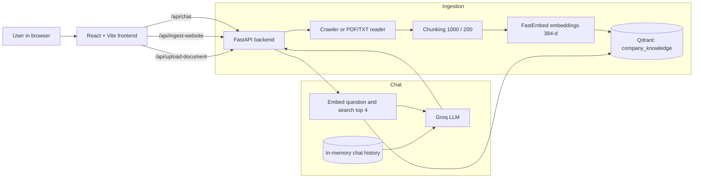

# Knowledge Assistant: RAG Chatbot (FastAPI + Qdrant + Groq + React)

A chatbot that answers questions **from your own content**: websites you crawl and PDF/TXT files you upload. It uses **RAG (Retrieval-Augmented Generation)**.

---

## Table of Contents

1. [What is RAG? (read this first)](#1-what-is-rag-read-this-first)
2. [Tech stack](#2-tech-stack)
3. [Architecture](#3-architecture)
4. [Project structure](#4-project-structure)
5. [Requirements](#5-requirements)
6. [Accounts to open](#6-accounts-to-open)
7. [Environment variables](#7-environment-variables)
8. [Run locally](#8-run-locally)
9. [API reference](#9-api-reference)
10. [How it was built: step-by-step roadmap](#10-how-it-was-built-step-by-step-roadmap)
11. [Deployment](#11-deployment)
12. [Known issues and next improvements](#12-known-issues-and-next-improvements)
13. [Troubleshooting](#13-troubleshooting)

---

## 1. What is RAG? (read this first)

An LLM (like GPT) only knows what it was trained on. It does **not** know your company's website or PDFs.
RAG fixes this in two phases.

| Phase | Name | What happens |
|---|---|---|
| A | **Ingestion** (one time per document) | Text → cut into **chunks** → each chunk turned into an **embedding** → saved in a **vector database** |
| B | **Question answering** (every chat message) | Question → embedding → find the **4 most similar chunks** → give them to the LLM as **context** → LLM writes the answer |

Key terms (each is used later in this file):

- **Chunk**: a small piece of text (here ~1000 characters). LLMs and search work better on small pieces than whole documents.
- **Chunk overlap**: the last 200 characters of one chunk repeat at the start of the next, so a sentence cut in half is not lost.
- **Embedding**: a list of numbers (a vector) that represents the *meaning* of text. Similar meaning → similar numbers. Here: **384 numbers** per text.
- **Vector database**: a database that stores embeddings and quickly finds the ones closest to a query. Here: **Qdrant**.
- **Similarity search**: "find chunks whose embedding is closest to the question's embedding".
- **Context**: the retrieved chunks pasted into the LLM prompt.
- **Session memory**: previous Q&A pairs sent along so follow-up questions ("what about its price?") make sense.

---

## 2. Tech stack

| Layer | Technology | Why |
|---|---|---|
| Backend API | **FastAPI** (Python) | Fast, automatic Swagger docs, Pydantic validation |
| Chunking | **LangChain** `RecursiveCharacterTextSplitter` | Splits on paragraphs → sentences → words |
| Embeddings | **FastEmbed** (`sentence-transformers/all-MiniLM-L6-v2`) | Runs locally, free, no API key, 384 dimensions |
| Vector DB | **Qdrant Cloud** (+ `langchain-qdrant`) | Managed, free tier |
| LLM | **Groq** (`openai/gpt-oss-20b`) | Very fast inference, free tier |
| Website crawling | `requests` + **BeautifulSoup4** | Download pages, extract text and links |
| PDF reading | **pypdf** | Extract text from PDF pages |
| Frontend | **React 18 + Vite 5** | Chat UI, website panel, document panel |
| Hosting | **Vercel** (frontend) + any Python host for the API | See [Deployment](#11-deployment) |

---

## 3. Architecture



**Chat flow in 6 steps**

1. Frontend sends `{question, session_id}` to `POST /api/chat`.
2. Backend loads the history for that `session_id`.
3. Question is embedded and Qdrant returns the **4 closest chunks** (`k=4`).
4. Chunks + history + question are sent to Groq.
5. Answer is saved in the session history.
6. Answer is returned to the frontend.

---

## 4. Project structure

```
project-root/
├── app/                              # Python backend (package)
│   ├── main.py                       # FastAPI app, CORS, the 4 endpoints
│   ├── config.py                     # get_required_env() + .env loading
│   ├── models/
│   │   └── chat_models.py            # Pydantic request/response schemas
│   ├── memory/
│   │   └── chat_memory.py            # In-memory chat history per session
│   ├── vector_db/
│   │   └── vector_store.py           # Qdrant connection + store_document()
│   └── services/
│       ├── text_chunking.py          # split_text_into_chunks()
│       ├── embedding_service.py      # FastEmbed model (lazy-loaded)
│       ├── document_ingestion.py     # PDF/TXT → text
│       ├── website_ingestion.py      # BFS website crawler
│       ├── llm_services.py           # Groq call + prompt
│       └── rag_service.py            # retrieve_context() + generate_rag_answer()
├── frontend/                         # React + Vite UI
│   ├── index.html
│   ├── vite.config.js                # Dev proxy: /api → http://localhost:8000
│   ├── package.json
│   └── src/
│       ├── main.jsx                  # React entry point
│       ├── App.jsx                   # Header, API status badge, tabs
│       ├── api.js                    # All fetch() calls in one place
│       ├── styles.css
│       └── components/
│           ├── ChatPanel.jsx         # Chat UI
│           ├── WebsitePanel.jsx      # URL + max-pages form
│           └── DocumentPanel.jsx     # Drag-and-drop PDF/TXT upload
├── requirements.txt                  # (create from section 5)
└── .env                              # secrets, never commit
```

Run backend commands from **project-root** (the folder that contains `app/`), because the code imports `app.services...`.

---

## 5. Requirements

### Software

| Tool | Version | Check with |
|---|---|---|
| Python | 3.10 or newer | `python --version` |
| Node.js | 18 or newer (includes npm) | `node --version` |
| Git | any | `git --version` |

### Python packages: create `requirements.txt`

```text
fastapi
uvicorn[standard]
python-multipart        # needed by FastAPI for file uploads
python-dotenv
requests
beautifulsoup4
pypdf
pydantic
groq
qdrant-client
langchain-core
langchain-community
langchain-qdrant
langchain-text-splitters
fastembed
```

> Tip: once everything works on your machine, run `pip freeze > requirements.txt` to pin exact versions.

### Frontend packages (already in `frontend/package.json`)

`react`, `react-dom`, `vite`, `@vitejs/plugin-react`. Installed with `npm install`.

### Hardware note

FastEmbed downloads the embedding model (~90 MB) on first use. Hosting needs roughly **1 GB RAM** or more.

---

## 6. Accounts to open

| # | Account | Used for | Cost | What you copy out |
|---|---|---|---|---|
| 1 | **Groq** (console.groq.com) | LLM answers | Free tier | `GROQ_API_KEY` (Console → API Keys → Create) |
| 2 | **Qdrant Cloud** (cloud.qdrant.io) | Vector database | Free 1 GB cluster | `QDRANT_URL` + `QDRANT_API_KEY` |
| 3 | **GitHub** | Source code, deploy triggers | Free | Repository |
| 4 | **Vercel** (vercel.com) | Host the React frontend | Free hobby | Frontend URL |
| 5 | **Backend host** (e.g. Render, Railway, Fly.io, or a VPS) | Host FastAPI | Free/paid tier | Backend URL |

### Set up Qdrant (step by step)

1. Sign up at cloud.qdrant.io → **Create cluster** → choose Free.
2. Open the cluster → copy the **Cluster URL** (looks like `https://xxxx.cloud.qdrant.io:6333`).
3. Go to **API Keys** → create a key → copy it (shown once).
4. Create the collection, **once**. Run this function a single time, with your `.env` filled:

```python
# create_collection.py  (run once: python create_collection.py)
import os
from dotenv import load_dotenv
from qdrant_client import QdrantClient
from qdrant_client.models import Distance, VectorParams

load_dotenv()

def create_collection(name: str = "company_knowledge") -> None:
    client = QdrantClient(
        url=os.getenv("QDRANT_URL"),
        api_key=os.getenv("QDRANT_API_KEY"),
    )
    if client.collection_exists(name):
        print(f"'{name}' already exists")
        return
    client.create_collection(
        collection_name=name,
        vectors_config=VectorParams(size=384, distance=Distance.COSINE),
    )
    print(f"Created '{name}'")

if __name__ == "__main__":
    create_collection()
```

Why `size=384`? The embedding model `all-MiniLM-L6-v2` outputs 384 numbers per text. The collection must match exactly. If you change the embedding model, change this size and recreate the collection.

---

## 7. Environment variables

Create a file named `.env` in **project-root**:

```env
GROQ_API_KEY=gsk_xxxxxxxxxxxxxxxxxxxxxxxx
QDRANT_URL=https://xxxx.cloud.qdrant.io:6333
QDRANT_API_KEY=xxxxxxxxxxxxxxxxxxxxxxxx
```

| Variable | Read in | Purpose |
|---|---|---|
| `GROQ_API_KEY` | `llm_services.py` (Groq SDK reads it automatically) | Authenticates LLM calls |
| `QDRANT_URL` | `vector_store.py` | Qdrant cluster address |
| `QDRANT_API_KEY` | `vector_store.py` | Qdrant authentication |
| `VITE_API_URL` *(frontend, production only)* | `frontend/src/api.js` | Backend base URL. **Must end with `/api`**, e.g. `https://my-backend.com/api` |

`.env` is listed in `.gitignore`. **Never push it to GitHub.**

---

## 8. Run locally

### Step 1: Backend

```bash
# from project-root
python -m venv venv
source venv/bin/activate            # Windows: venv\Scripts\activate
pip install -r requirements.txt

# create .env (section 7), create the Qdrant collection (section 6), then:
uvicorn app.main:app --reload --port 8000
```

- API is at http://localhost:8000
- Interactive docs (Swagger) at **http://localhost:8000/api/docs**
- First request that touches embeddings is slow, because the model downloads once.

### Step 2: Frontend

```bash
cd frontend
npm install
npm run dev
```

Open **http://localhost:5173**. The top-right badge should say **"API online"**.
In development, `vite.config.js` proxies `/api/*` to `localhost:8000`, so no CORS setup is needed.

### Step 3: Try it

1. **Website** tab → enter a URL, choose max pages → *Ingest website*.
2. or **Documents** tab → drop a PDF/TXT → *Upload*.
3. **Chat** tab → ask a question about that content.

### Quick smoke tests (each service on its own)

Each service file has a `__main__` block, so you can test a layer without the whole app:

```bash
python -m app.services.text_chunking        # prints chunks
python -m app.services.embedding_service    # prints 384 dims
python -m app.services.website_ingestion    # crawls a sample site
python -m app.vector_db.vector_store        # stores a sample doc in Qdrant
```

---

## 9. API reference

Base URL: `http://localhost:8000` (local). All routes start with `/api`.

| Method | Path | Purpose |
|---|---|---|
| GET | `/api/health` | Is the server up? |
| POST | `/api/chat` | Ask a question (RAG answer) |
| POST | `/api/ingest-website` | Crawl a website and store it |
| POST | `/api/upload-document` | Upload PDF/TXT and store it |
| GET | `/api/docs` | Swagger UI |

---

### 9.1 `GET /api/health`

Used by the frontend to show the "API online/offline" badge.

```bash
curl http://localhost:8000/api/health
```
```json
{ "status": "healthy" }
```

---

### 9.2 `POST /api/chat`

**Request body (JSON)**

| Field | Type | Required | Notes |
|---|---|---|---|
| `question` | string | yes | User's question |
| `session_id` | string | no (default `"default"`) | Same ID = same conversation memory. Frontend generates a UUID per page load |

```bash
curl -X POST http://localhost:8000/api/chat \
  -H "Content-Type: application/json" \
  -d '{"question": "What services does the company provide?", "session_id": "abc-123"}'
```

**Response 200**
```json
{ "answer": "The company provides web development and AI chatbots.", "session_id": "abc-123" }
```

**Errors**: `422` (invalid body), `500` ("Unable to generate a chat response. Please try again.").

**What happens inside** (`rag_service.generate_rag_answer`)

1. `get_chat_history(session_id)` → past Q&A.
2. `retrieve_context(question)` → Qdrant `similarity_search(k=4)` → join chunk texts.
3. `generate_answer(question, context, history)` → Groq call. System prompt says: *answer from the company information; if not there, say so*.
4. `save_chat_message(...)` → store Q&A in memory.

---

### 9.3 `POST /api/ingest-website`

**Request body (JSON)**

| Field | Type | Required | Rules |
|---|---|---|---|
| `url` | string (valid URL) | yes | Start page |
| `max_pages` | integer | no (default `10`) | 1 to 100 |

```bash
curl -X POST http://localhost:8000/api/ingest-website \
  -H "Content-Type: application/json" \
  -d '{"url": "https://example.com", "max_pages": 5}'
```

**Response 200**
```json
{
  "message": "Website ingestion completed successfully!",
  "total_pages": 5,
  "total_chunks_stored": 23
}
```

**Errors**: `422` (bad URL or `max_pages` out of range), `502` ("Unable to fetch website: …").

**What happens inside**

1. `crawl_website()` does a **breadth-first crawl** using a queue: download page → extract title/text → collect links → keep only **same-domain** links → repeat until `max_pages`.
2. Text cleaning removes `nav`, `footer`, `script`, `style` tags and collapses whitespace.
3. For each page, `store_document()` chunks → embeds → saves to Qdrant with metadata (`source`, `title`, `source_type`, `chunk_index`).

---

### 9.4 `POST /api/upload-document`

**Request**: `multipart/form-data` with one field `file` (`.pdf` or `.txt`).

```bash
curl -X POST http://localhost:8000/api/upload-document \
  -F "file=@company_info.pdf"
```

**Response 200**
```json
{
  "message": "Document uploaded and stored successfully!",
  "filename": "company_info.pdf",
  "total_chunks_stored": 12
}
```

**Errors**

| Status | When |
|---|---|
| 400 | Extension is not `.pdf` / `.txt` ("Only PDF and TXT files are supported.") |
| 400 | No extractable text (e.g. a scanned-image PDF) |
| 422 | `file` field missing |

**What happens inside**: `extract_document_text()` (pypdf for PDF, UTF-8 decode for TXT) → `store_document()` (chunk → embed → Qdrant).

---

## 10. How it was built: step-by-step roadmap

Each phase produces something you can test before moving on.

### Phase 0: Plan and set up

1. Decide the goal: *a chatbot that answers from our own website/documents.*
2. Create folders `app/` and `frontend/`; create a virtual environment.
3. Create `.gitignore` (`.env`, `venv/`, `__pycache__/`, `node_modules/`, `dist/`).
4. Open Groq and Qdrant accounts; put keys in `.env`.
5. `config.py`: `load_dotenv()` plus `get_required_env(name)` that raises a clear error if a variable is missing.

### Phase 1: Chunking (`text_chunking.py`)

- **Concept**: long text must be cut into pieces small enough to embed and retrieve precisely.
- **Function**: `split_text_into_chunks(text)` using `RecursiveCharacterTextSplitter(chunk_size=1000, chunk_overlap=200)`.
- **Test**: run the file; it prints the number of chunks and each chunk.

### Phase 2: Embeddings (`embedding_service.py`)

- **Concept**: convert text to a 384-number vector that captures meaning.
- **Function**: `get_embeddings()` creates the FastEmbed model **once** and reuses it (lazy singleton) so the model isn't reloaded per request. `batch_size=16, threads=1` keeps memory low on small servers.
- **Test**: run the file; it prints `Embedding dimensions: 384`.

### Phase 3: Vector database (`vector_store.py`)

- **Concept**: store vectors + metadata, search by similarity.
- **Functions**:
  - `get_vector_store()` → connects to Qdrant, collection `company_knowledge`.
  - `store_document(document)` → chunk → wrap each chunk in a LangChain `Document` with metadata → `add_documents()` → return chunk count.
- **Test**: run the file; it stores a sample and prints the chunk count. Check the Qdrant dashboard for points.

### Phase 4: Document ingestion (`document_ingestion.py`)

- **Function**: `extract_document_text(filename, file_bytes)`.
- PDF → `PdfReader` → join text from each page. TXT → decode UTF-8. Anything else → `ValueError`.
- Returns `{filename, content, source_type}`, the same shape the website crawler returns, so `store_document()` handles both.

### Phase 5: Website ingestion (`website_ingestion.py`)

Built as small single-purpose functions:

| Function | Job |
|---|---|
| `fetch_page(url)` | GET with browser-like headers, 15 s timeout, raise on HTTP errors |
| `extract_links(html)` | All `<a href>` values |
| `filter_internal_links(base, links)` | Convert relative → absolute; keep same-domain http/https only |
| `extract_text(html)` | Remove nav/footer/script/style, get visible text |
| `extract_title(html)` | `<title>` or "Untitled Page" |
| `clean_text(text)` | Collapse whitespace |
| `crawl_website(url, max_pages)` | BFS with a `deque` queue and `visited` set |

### Phase 6: LLM (`llm_services.py`)

- **Concept**: the LLM writes the final answer using the retrieved context.
- **Function**: `generate_answer(question, context, chat_history)`.
- The system prompt contains the context and tells the model to say so if the answer isn't in it.
- History is converted into `user` / `assistant` messages, followed by the new question.
- Model: `openai/gpt-oss-20b` on Groq.

### Phase 7: Memory (`chat_memory.py`)

- A dictionary `{session_id: [{question, answer}, ...]}`.
- `get_chat_history(session_id)` and `save_chat_message(session_id, q, a)`.
- Simple and fast. It resets when the server restarts (see [improvements](#12-known-issues-and-next-improvements)).

### Phase 8: RAG pipeline (`rag_service.py`)

- `retrieve_context(question)`: similarity search, top 4, joined into one string.
- `generate_rag_answer(question, session_id)`: history → retrieve → LLM → save → return.

### Phase 9: API layer (`main.py` + `chat_models.py`)

1. Pydantic models: `ChatRequest`, `ChatResponse`, `WebsiteIngestionRequest` (URL validated, `max_pages` 1 to 100).
2. Endpoints: `/api/health`, `/api/chat`, `/api/ingest-website`, `/api/upload-document`.
3. Error mapping: network failures → 502, bad input → 400, anything else → 500 with a safe message (details go to the log, not the user).
4. Swagger moved to `/api/docs`.
5. CORS middleware so the deployed frontend may call the API.
6. Test every endpoint in Swagger before touching the frontend.

### Phase 10: Frontend (React + Vite)

1. `npm create vite@latest` → React template.
2. `vite.config.js`: proxy `/api` → `localhost:8000` (no CORS pain in dev).
3. `api.js`: one `fetch` wrapper that converts FastAPI error bodies (`detail`) into readable messages; four functions `checkHealth`, `sendChat`, `ingestWebsite`, `uploadDocument`.
4. `App.jsx`: header with live API status badge + three tabs (Chat, Website, Documents).
5. `ChatPanel.jsx`: message list, typing indicator, suggestion chips, Enter to send / Shift+Enter for a new line, `crypto.randomUUID()` as `session_id`.
6. `WebsitePanel.jsx`: URL input, max-pages slider, loading and error states.
7. `DocumentPanel.jsx`: drag-and-drop zone, extension check on the client, upload button.

### Phase 11: Test end to end

Ingest a site or PDF → ask 3 to 5 questions, including one follow-up ("tell me more about that") and one question **not** in the content (it should say it doesn't know).

### Phase 12: Deploy

See next section.

---

## 11. Deployment

The frontend and backend are deployed separately.

### 11.1 Backend (FastAPI)

Works on any Python host (Render, Railway, Fly.io, VPS). Generic setup:

| Setting | Value |
|---|---|
| Build command | `pip install -r requirements.txt` |
| Start command | `uvicorn app.main:app --host 0.0.0.0 --port $PORT` |
| Env vars | `GROQ_API_KEY`, `QDRANT_URL`, `QDRANT_API_KEY` |
| Python | 3.10+ |
| Memory | about 1 GB or more (embedding model) |

Steps:
1. Push the code to GitHub (without `.env`).
2. Create a new web service on your host and connect the repo.
3. Set the build/start commands and environment variables above.
4. Deploy, then open `https://<backend-url>/api/health`. It should return `{"status":"healthy"}`.
5. Open `https://<backend-url>/api/docs` to test endpoints.

**Update CORS** in `app/main.py`: put your real frontend URL(s) in `allow_origins`, **without a trailing slash**:

```python
allow_origins=[
    "https://your-frontend.vercel.app",
]
```

### 11.2 Frontend (Vercel)

1. Import the GitHub repo in Vercel; set **Root Directory** to `frontend`.
2. Framework preset: **Vite** (build `npm run build`, output `dist`).
3. Add environment variable `VITE_API_URL = https://<backend-url>/api` (**include `/api`**).
4. Deploy. Open the site; the badge should show **API online**.
5. After changing `VITE_API_URL`, **redeploy**, because Vite bakes env vars in at build time.

### 11.3 Deployment checklist

- [ ] Groq key works
- [ ] Qdrant collection `company_knowledge` exists with size 384 / cosine
- [ ] Backend env vars set on the host
- [ ] `/api/health` returns healthy
- [ ] Frontend URL added to CORS
- [ ] `VITE_API_URL` ends with `/api`
- [ ] Upload a file and ask a question in production

---

## 12. Known issues and next improvements

**Things to fix (found while documenting)**

| # | Issue | Where | Fix |
|---|---|---|---|
| 1 | The Website and Documents panels read `result.pages` and `result.document`, but the API returns only `total_pages`, `total_chunks_stored`, `filename`. After a successful ingest the UI can show an error or crash. | `WebsitePanel.jsx`, `DocumentPanel.jsx` vs `main.py` | Either show the counts the API returns, or have the API also return the extracted pages/document text |
| 2 | A trailing slash in an allowed origin (`...vercel.app/`) will not match the browser's `Origin` header | `main.py` CORS list | Remove the trailing `/` |
| 3 | The Qdrant collection must exist before first use | `vector_store.py` | Run `create_collection.py` (section 6) or add `collection_exists` check in code |
| 4 | `requirements.txt` is missing from the project | project root | Create it from section 5 |
| 5 | `chat_history: list = []` mutable default argument | `llm_services.py` | Use `None` and create the list inside |
| 6 | Crawler stops the whole request if one page fails | `crawl_website` | Wrap each page fetch in `try/except` and continue |

**Possible upgrades**

- Store chat history in Redis or PostgreSQL so it survives restarts.
- Show **source citations** (chunk metadata already stores `source` and `title`).
- Avoid duplicates when the same site or file is ingested twice.
- Add authentication and rate limiting before sharing publicly.
- Support DOCX, and OCR for scanned PDFs.
- Stream the LLM answer token-by-token to the UI.

---

## 13. Troubleshooting

| Symptom | Likely cause | Fix |
|---|---|---|
| `Missing required environment variable` | `.env` not found or key missing | Put `.env` in project-root; check spelling |
| `ModuleNotFoundError: app` | Running from the wrong folder | Run from project-root, not inside `app/` |
| Collection not found error | Qdrant collection missing | Run `create_collection.py` |
| Vector size mismatch error | Collection size is not 384 | Recreate the collection with size 384 |
| Badge says "API offline" | Backend not running or wrong `VITE_API_URL` | Start `uvicorn`; check URL ends with `/api` |
| Browser CORS error in production | Frontend origin not in `allow_origins` | Add exact URL, no trailing slash |
| Upload returns 400 "No extractable text" | Scanned/image PDF | Use a text PDF or add OCR |
| First request very slow | Embedding model downloading | Wait once; it is cached afterwards |
| Out-of-memory on host | Plan too small for the model | Use a plan with 1 GB RAM or more |
| 502 on ingest | Site blocks bots or is unreachable | Try another URL; check it opens in a browser |

---

*Built with FastAPI, Qdrant, Groq and React.*
